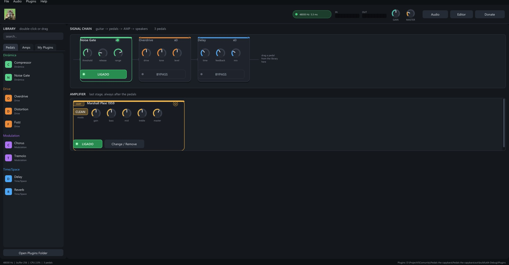

# Pedals the Capybara

[](https://github.com/gufavocapivara/PedalstheCapybara/actions/workflows/build.yml)
[](LICENSE)

English | [Português](README.md)

A real-time guitar pedalboard and amp simulator. Build your own pedals and amps in Lua, share them as `.pctp`/`.pp` packs, and shape your tone with a custom-built ImGui interface. Free and open-source (MIT).



## Download

**[Download the latest Windows build (ZIP)](https://github.com/gufavocapivara/PedalstheCapybara/releases/latest/download/PedalTheCapybara-windows-x64.zip)**

Unzip it and run `PedalTheCapybara.exe`. No installer, no build tools needed. The zip includes the starter packs; the `Plugins/` folder is created by the app on first run.

> An older installer is still available in the [v1.0-Beta release](https://github.com/gufavocapivara/PedalstheCapybara/releases/tag/v1.0-Beta).

## 30-second quick start

1. On the left, pick a pedal from the **Library** and drag it into the signal chain (double-click also works).
2. Amps are ordinary cards in the same chain — open the **Amps** tab and add one.
3. Turn a knob by dragging vertically, using the mouse wheel, `Shift` for fine adjustment, or double-click to reset.
4. Reorder cards by dragging them. Use the power button on a card to bypass it.
5. Import plugins with **Plugins > Import .pctp / .pp...** or drag the file onto the window.
6. Write/edit Lua pedals in **Plugins > Lua Editor**.

## Features

- Real-time DSP with miniaudio; configurable input/output device, buffer size and exclusive mode.
- Built-in pedals (gate, drive, modulation, time/space, dynamics) and amps.
- Lua plugins: scripts and images are bundled in `.pctp` (single plugin) or `.pp` (pack) ZIP files, read directly from memory.
- In-app Lua editor with image import and `.pctp` export.
- Searchable library with tabs: All / Pedals / Amps / My Plugins / Packs.
- Drag-and-drop of plugins, packs and images; status toasts and native file dialogs.
- Included packs: starter, BOSS-inspired and Comfortably Numb-inspired rigs (original DSP models, not circuit clones).

## Plugin formats

### Folder plugin (still supported)

```text
Plugins/
  my_drive.ptc        # NAME, DESCRIPTION, AUTHOR, VERSION, SCRIPT, ICON
  my_drive.lua
  my_drive_assets/
    face.png
    knob.png
```

### `.pctp` — one plugin in a ZIP

```text
plugin.ptc
my_drive.lua
assets/
  face.png
  knob.png
```

### `.pp` — a pack of plugins in a ZIP

```text
pack.ini              # optional: NAME/DESCRIPTION/AUTHOR/VERSION
MyDrive.pctp
AnotherPlugin/
  plugin.ptc
  script.lua
  assets/...
```

You can create a `.pp` from a folder inside the app: **Plugins > Create plugin pack (.pp)...**

## Build from source

```powershell
cmake -S . -B build
cmake --build build --config Release --parallel 8
ctest --test-dir build -C Release --output-on-failure
.\build\Release\PedalTheCapybara.exe
```

Dependencies are fetched automatically (GLFW, Dear ImGui, Lua, stb); miniaudio, miniz and portable-file-dialogs are vendored in `third_party/`.

To produce a distributable ZIP:

```powershell
cmake --build build --config Release --target package
# build/PedalTheCapybara-windows-x64.zip
```

## Code layout

The UI lives in `src/ui_*.cpp`; shared state and signatures are in `include/ui_shared.h`.

| File | Contents |
|---|---|
| `src/main.cpp` | startup, menu bar and main loop |
| `src/ui_theme.cpp` | style, fonts and DPI scale |
| `src/ui_widgets.cpp` | knobs, buttons, meters, textures |
| `src/ui_cards.cpp` | signal-chain cards, drag-and-drop, power button |
| `src/ui_library.cpp` | library rows |
| `src/ui_header.cpp` | header, icons, URL/folder opening |
| `src/ui_system.cpp` | OS integration (Win32/Shell) |
| `src/ui_toasts.cpp` | notifications and dropped files |
| `src/plugin_package.cpp` | `.pctp`/`.pp` reader (`package_lib`) |

`tests/smoke_packages.cpp` opens the bundled packs and validates manifests, Lua scripts and assets — no OpenGL or audio device required.

## Documentation

- [Lua API wiki](docs/wiki/Home.md)

## Contributing and support

Bug reports, plugin packs and documentation fixes are welcome. If the project is useful to you, star the repository, share your packs, and open an issue with ideas or problems.

## License

[MIT](LICENSE). Plugins and packs you distribute do not have to use the same license.
