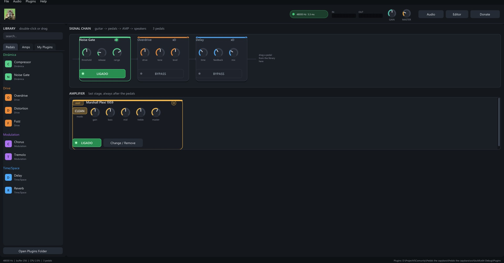

# Pedals the Capybara

[](https://github.com/gufavocapivara/PedalstheCapybara/actions/workflows/build.yml)
[](LICENSE)

Pedals the Capybara é um pedalboard/amp sim em tempo real para guitarra, escrito em C++ com Dear ImGui + GLFW/OpenGL, miniaudio e Lua.



<!-- Para uma demonstração animada: grave ~10 s arrastando um pedal para a cadeia,
     salve como docs/demo.gif e descomente a linha abaixo:

-->

## O que mudou nesta reformulação

- **Imagens em plugins**: cards renderizam texturas (`basetexture`, `knobtexture`, `ledtexture`, `footswitchtexture`, `labeltexture`) tanto em plugins de pasta quanto dentro de pacotes.
- **Amp na mesma cadeia**: amps não ficam mais em slot fixo separado; são pedais normais com `isAmp=true` e podem ser ligados/desligados e arrastados na mesma signal chain.
- **`.pctp` (plugin package)**: ZIP contendo manifesto, script Lua e assets. O app lê diretamente.
- **`.pp` (plugin pack)**: ZIP contendo vários plugins/pacotes. O app importa e lista por pack; também dá para criar um `.pp` a partir de uma pasta pela UI.
- **Editor melhorado**: importar imagens, testar com assets em memória, salvar plugin em pasta, exportar `.pctp`.
- **UX**: busca na biblioteca, abas All/Pedals/Amps/My Plugins/Packs, drag-and-drop de arquivos (`.pctp/.pp/.ptc/.lua/imagens`), toasts de status/erro, dialogs nativos.
- **Exclusão**: na Library, selecione um plugin/pack e use **Delete... / Delete pack...** para remover do disco (com confirmação e checagem de caminho).
- **Packs incluídos**: demos em `Demos/` e packs prontos em `Packs/` (starter, BOSS inspired e rig Comfortably Numb).

## Formatos

### Plugin de pasta (compatível)
```text
Plugins/
  my_drive.ptc        # NAME, DESCRIPTION, AUTHOR, VERSION, SCRIPT, ICON
  my_drive.lua
  my_drive_assets/
    face.png
    knob.png
```

### `.pctp` (um plugin, ZIP)
```text
plugin.ptc
my_drive.lua
assets/
  face.png
  knob.png
```

### `.pp` (plugin pack, ZIP)
```text
pack.ini              # opcional: NAME/DESCRIPTION/AUTHOR/VERSION
MyDrive.pctp
AnotherPlugin/
  plugin.ptc
  script.lua
  assets/...
```

## Build (Windows)

```powershell
cmake -S . -B build
cmake --build build --config Release --parallel 8
ctest --test-dir build -C Release --output-on-failure
.\build\Release\PedalTheCapybara.exe
```

Para gerar um zip distribuível (exe + `Plugins/` + `Packs/` + README + LICENSE):

```powershell
cmake --build build --config Release --target package
# build/PedalTheCapybara-windows-x64.zip
```

Dependências são baixadas via FetchContent (GLFW, Dear ImGui, Lua, stb) e bibliotecas vendorizadas em `third_party/` (miniaudio, miniz, portable-file-dialogs).

## Estrutura do código

A interface fica em `src/ui_*.cpp`, com estado e assinaturas compartilhadas em `include/ui_shared.h`:

| Arquivo | Conteúdo |
|---|---|
| `src/main.cpp` | inicialização, menu e loop principal |
| `src/ui_theme.cpp` | estilo, fontes e escala de DPI |
| `src/ui_widgets.cpp` | knobs, botões, meters e texturas |
| `src/ui_cards.cpp` | cards da cadeia, drag-and-drop e power button |
| `src/ui_library.cpp` | linhas da biblioteca de pedais/amps |
| `src/ui_header.cpp` | cabeçalho, ícones e abertura de URLs/pastas |
| `src/ui_system.cpp` | integrações com o sistema (Shell/Win32) |
| `src/ui_toasts.cpp` | notificações e arquivos arrastados |
| `src/plugin_package.cpp` | leitura de `.pctp`/`.pp` (`package_lib`) |

O teste de smoke `tests/smoke_packages.cpp` abre os packs incluídos e valida manifestos, scripts Lua e assets — sem precisar de OpenGL ou áudio.

## Licença

[MIT](LICENSE). Plugins e packs distribuídos junto não precisam adotar a mesma licença.

## Packs incluídos

- `Packs/CapybaraStarter.pp` — pack de demonstração (Golden Echo, Velvet Chorus, Tape Warmth).
- `Packs/BossInspired.pp` — MD-2, DS-1, SD-1, BD-2 e MT-2 inspirados nos controles documentados pela BOSS. Modelos DSP originais; não são clones de circuito nem afiliados à BOSS/Roland.
- `Packs/ComfortablyNumbRig.pp` — rig de solo inspirado (comp, sustain/fuzz, modulação, delay e amp). Modelos DSP originais; não afiliado a Pink Floyd/BOSS/EHX/Hiwatt.
- `Packs/ComfortablyNumbSolo.pp` — alias do rig acima para importação rápida.

Os packs também podem ser importados arrastando o `.pp` para a janela ou usando **Import .pctp / .pp...** na Library.

## Criar plugin pack

1. Crie uma pasta com seus plugins (`.pctp`, ou pastas com `.ptc/.lua/assets`).
2. No app: **Plugins > Create plugin pack (.pp)...** ou botão **Create pack...** na Library.
3. Escolha a pasta e o destino `.pp`.

## Excluir plugins/packs

Selecione o item na Library e clique em **Delete...** (plugin de pasta/pacote avulso) ou **Delete pack...** (item vindo de um `.pp`). A remoção apaga os arquivos do disco; plugins que já estão na cadeia continuam ativos até serem removidos da cadeia.

## Documentação

- [Lua API Wiki](docs/wiki/Home.md)
